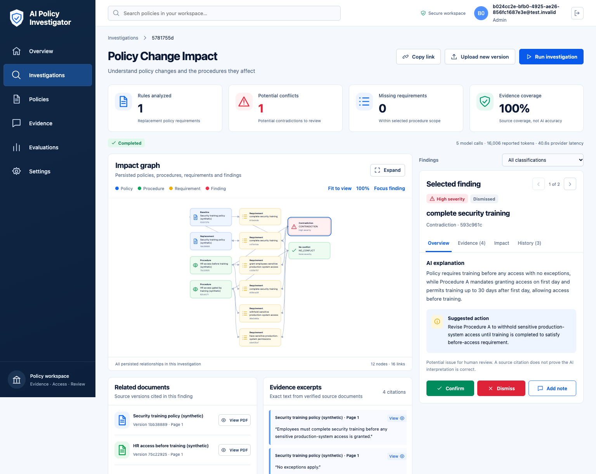

# AI Policy Investigator — Angular frontend

Built for the Meta Global AI Developer Hackathon 2026.

An analyst uploads a policy change, compares it with selected procedures and reviews
potential conflicts with exact source evidence. This Angular dashboard connects to
the Java backend and Meta Muse (`muse-spark-1.3`) through authenticated backend APIs.
There are no client-side model calls or fabricated findings/KPIs.

- Frontend: [ThierryTe/ai-policy-invetigator-frontend](https://github.com/ThierryTe/ai-policy-invetigator-frontend).
- Backend: [ThierryTe/ai-policy-invetigator](https://github.com/ThierryTe/ai-policy-invetigator).

## Real demonstration and screenshots

The [repeatable Muse demo](docs/REAL_DEMO.md) contrasts training **before sensitive-system
access** with **day-one access and training within 30 days**, plus a compatible control
that withholds access until training. It uses synthetic PDFs, explicit processing
consent, real inference, persisted citations and human review.



Existing [mobile](docs/screenshots/mobile-fitted-investigation.png) and
[original PDF](docs/screenshots/pdf-real-source.png) captures show genuine local results.
Analysts confirm, dismiss or annotate a finding while preserving its original AI
classification, evidence and review history. These are local demonstration screenshots,
not proof of a running public site.

The [October 28 browser run](docs/focused-demo-verification.json) found CONTRADICTION
and NO_CONFLICT and verified all eight published finding citation instances. It reported
five calls, 6,589 prompt / 9,417 completion tokens and 40,605 ms summed metered provider
latency. This is a workflow demonstration, separate from the backend evaluation.

## Run locally

Use Node 22 and npm 11.8.0, matching the CI and the declared package manager.
See Angular's [compatibility matrix](https://v21.angular.dev/reference/versions)
for supported Node releases.

```sh
npm ci
npm start
```

Open `http://127.0.0.1:4200`. The Angular development proxy sends `/api/**` to the
backend on `http://127.0.0.1:18080`; first follow the backend's
[local setup](https://github.com/ThierryTe/ai-policy-invetigator/blob/main/docs/SETUP.md)
and [demo provisioning](https://github.com/ThierryTe/ai-policy-invetigator/blob/main/docs/DEMO.md). No CORS change, frontend secret or Meta key is required.
Use an account provisioned through the backend's existing operator process. There
is no sign-up or password-reset endpoint, and no default credential is supplied.

The selected investigation URL survives navigation but **authentication does not
survive a reload**: sign in again. Tokens are intentionally kept only in memory.

## Implemented workflow

1. Login and load current identity/department memberships.
2. Upload policy/procedure PDFs and poll durable ingestion; inspect immutable
   version history and original PDFs. Add replacement versions with the latest
   predecessor; file limits and metadata are validated again by the backend.
3. An owning-department administrator explicitly allows external processing for
   each contributing document. Uploading does not imply consent.
4. Select indexed baseline/replacement versions, one to four procedure versions
   and an analysis date. The server rechecks permissions, lineage and consent.
5. Poll investigation stages; display completed, partial, failed, empty and network
   error states. Incomplete work never displays zero conflicts as a successful result.
6. Inspect classifications, source-backed explanations and suggested actions.
   The graph uses only backend-provided persisted nodes/edges; focusing filters
   those links without generating new relationships. Use keyboard/scroll controls,
   expand the graph or select a requirement to resolve its exact source.
7. Resolve authorized citations with page/version references and open source PDFs.
8. Confirm, dismiss or add a note when `canReview` permits it. History retains
   reviewer UUIDs/timestamps and prior decisions; AI output remains immutable.
9. Navigate current account memberships, evidence lookup and recent investigations
   created in this session. Shared UUID links reopen authorized investigations.

The API does **not** publish evaluation results, an investigation-history listing,
full-text global search, notification events, account display names or exported
report files. Evaluations therefore shows an honest unavailable state. Search
filters policy titles on the current paginated library page. The investigation
selector supports document pagination and keeps selected procedures across pages.
No unsupported endpoint was invented.

## Overview and impact graph

Overview rechecks known current-session investigation IDs through the existing
individual progress API before displaying their status/link. Unreadable scopes are
omitted and retrieval errors are not shown as empty history. The backend has no
investigation-list API, so earlier session history cannot be discovered automatically;
open a saved URL/ID instead. No backend endpoint or global-history claim was added.

The graph initially fits the full persisted layout without clipped nodes. It
recalculates on resize, focus changes and expansion. **100%** restores the existing
scrollable layout for reading; **Fit to view** restores the complete overview.
Node coordinates, relationships, source navigation and selection are preserved.


## Architecture and security

Angular 21 standalone components, explicit OnPush, built-in control flow,
`signal`/`computed`, signal `input`/`output` and HttpClient. RxJS handles HTTP,
mutation exclusion and polling; `toSignal` is the presentation boundary and owns
subscription cleanup. Effects are used for session expiry and session-history
cleanup. There is no NgRx, Angular Material dashboard or manual component subscription.

Features are grouped under `src/app/features/`; `core/contracts.ts` preserves the
actual camel-case DTOs and documented snake-case SQL projections. The backend's
[dashboard API contract](https://github.com/ThierryTe/ai-policy-invetigator/blob/main/docs/api/phase4.md)
and controllers are authoritative; [the frontend API map](docs/API.md) records the exact routes used.

- Bearer tokens attach only to relative `/api/` requests, never third-party URLs.
  No localStorage/sessionStorage, cookies or service-worker content cache is used.
- Sign-out/session expiry clears identity, prior-user URL query text and session history, cancels in-flight
  API requests and destroys protected views. A 401 ends the session; 403/404/errors
  never create findings or success states. Review permissions remain server-authoritative.
- Excerpts/model reasoning/notes are text bindings, never `innerHTML`. PDF trust
  applies only to locally created Blob URLs from authenticated PDF responses;
  URLs are revoked when the viewer closes or its protected view is destroyed.
- No model key, database password or JWT signing secret belongs in the frontend.
  Fixture credentials, dotenv files, dependencies and build/test output are ignored
  and excluded from Docker's build-context allowlist.
- Production uses same-origin `/api` proxying, no API caching, non-root Nginx,
  strict script CSP and denied documentation routes. Angular critical CSS inlining
  is disabled so stylesheet loading does not depend on CSP-blocked inline handlers.

## Build and focused tests

```sh
npm run build -- --configuration production
npm test
```

The lockfile is committed source material; use `npm ci`, including in Docker.
Two explicit **build-only** WASM peer dependencies avoid a demonstrated macOS/Linux
lock inconsistency, following the upstream maintainer's
[documented workaround](https://github.com/napi-rs/napi-rs/issues/3174).
The runtime image contains static output only, not Node, testing tools or fixtures.
No dependency override or unsupported Angular version was forced.

## Real browser verification (explicit opt-in)

The workflow test uploads four synthetic PDFs and makes real Meta calls through the
backend authorization/consent gates. It does not intercept API requests or return fixture
model outputs. Use a dedicated local database; calls can incur provider usage. First
prepare the backend's ignored `.local/runtime.env` for the SQL fixture helper, keeping
its values consistent with the local database as described in
[evaluation setup](https://github.com/ThierryTe/ai-policy-invetigator/blob/main/docs/EVALUATION.md#reproduce-safely).
Keep a local frontend server running at the selected E2E URL. The example uses the
[local Docker frontend](#local-docker-compose) on port 18081.

```sh
python3 scripts/prepare_browser_fixture.py --backend ../aI-policy-investigator-backend
npx playwright install chromium
E2E_DATA_DIR="$PWD/.e2e-data" E2E_BASE_URL=http://127.0.0.1:18081 \
  npx playwright test e2e/workflow.spec.ts
E2E_DATA_DIR="$PWD/.e2e-data" E2E_BASE_URL=http://127.0.0.1:18081 \
  npx playwright test e2e/visual.spec.ts
python3 scripts/prepare_browser_fixture.py --backend ../aI-policy-investigator-backend --cleanup
```

Provisioning creates isolated synthetic users through the backend's existing local
operator helper; credentials are written only to `.e2e-data/credentials.json` with
mode 0600, not printed. Each full workflow run needs a fresh fixture organization;
prepare again before repeating it. The visual test reuses the completed real
investigation recorded by the workflow test, without another model request. The
cleanup option disables fixture accounts and retains immutable evidence.

Browser traces/video and automatic failure screenshots are disabled to avoid
recording credential entry or tokens. Deliberate committed screenshots contain only
synthetic documents, generated reviewer identities and actual model results.
The [real-demo guide](docs/REAL_DEMO.md) and [recorded browser evidence](docs/browser-verification.json)
describe dated local runs; they do not establish current production health. The visual
test reads `docs/browser-verification.json`, so the commands above leave the workflow
test's default report path unchanged. Tests deliberately update reports/screenshots;
review those artifacts before publishing them.

## Local Docker Compose

Start the backend's local Compose deployment first, including `postgres`, `model-init`
and `backend`. Then, from this frontend checkout:

```sh
docker compose up --build -d --wait
```

Open `http://127.0.0.1:18081`. The local `frontend` service publishes
`127.0.0.1:18081:8080`, joins external network `ai-policy-investigator_default` and
routes `/api/` to `backend:8080`. Its healthcheck probes `/healthz`; backend readiness
must be checked separately through the API. For a custom local network, set
`BACKEND_NETWORK` and `BACKEND_UPSTREAM` to the actual backend network/address.
These are server-side routing values, not credentials or browser-controlled URLs.

The Dockerfile uses pinned Node/Nginx image digests, npm 11.8.0 and the lockfile.
No frontend settings or secrets need to be embedded from `.env`.

## Automatic production CI/CD

[Frontend CI](.github/workflows/verify.yml) validates pushes to develop/main and pull
requests targeting main. On a main push in `ThierryTe/ai-policy-invetigator-frontend`,
successful validation is configured to call the backend's shared publication and
deployment workflows with `component: frontend`. The chain is **verify → publish → deploy**,
using GitHub Environment **prod** in the calling repository. Normal validation runs
do not call Meta or need production secrets.

The existing image packages are:

```text
ghcr.io/thierryte/ai-policy-invetigator
ghcr.io/thierryte/ai-policy-invetigator-model-init
ghcr.io/thierryte/ai-policy-invetigator-frontend
```

Production uses the backend-owned
[frontend production overlay](https://github.com/ThierryTe/ai-policy-invetigator/blob/main/deploy/frontend/compose.production.yaml)
and [image overlay](https://github.com/ThierryTe/ai-policy-invetigator/blob/main/deploy/frontend/compose.ghcr.yaml).
They remove the local host port/build, use verified local images without pulls, and
connect the frontend to `ai-policy-investigator_application` and
`nginx-proxy-manager_default`. Nginx Proxy Manager targets `ai-policy-investigator-web:8080`;
the API upstream is `backend.ai-policy-investigator_application:8080`. Backend and
PostgreSQL are private, with no production host ports. The local Compose command above
does not install this production topology.

The workflow passes the existing host, user, private-key, port and project-path SSH
inputs to backend tooling. The public `prod` environment variable `VPS_HOST_KEY`
pins the server's Ed25519 public host key; the transfer helper constructs `known_hosts`
locally and retains `StrictHostKeyChecking=yes`. No additional GitHub secret is needed.
See the backend's
[current SSH configuration](https://github.com/ThierryTe/ai-policy-invetigator/blob/main/docs/PRODUCTION_PIPELINE.md#current-ssh-configuration)
and [operations guide](https://github.com/ThierryTe/ai-policy-invetigator/blob/main/docs/DEPLOYMENT.md).
No successful VPS deployment, public DNS/TLS configuration or public-site availability
is established by the local screenshots or tests.

## Evaluation and MVP limits

The backend's ten-case real-Muse evaluation matched **6/10**, with **four processing
errors**. A separate four-case exception retry matched **3/4**, including **one false
positive** against the unchanged expected label. Across those two runs: 31 calls,
38,359 prompt / 68,141 completion tokens, 296,572 ms summed metered provider latency
and 119/119 verified source/quote instances. The retry does not replace the original
errors or establish single-run 90% accuracy. See
[evaluation and original reports](https://github.com/ThierryTe/ai-policy-invetigator/blob/main/docs/EVALUATION.md).

Citation matching establishes source correspondence, not correct interpretation.
Evidence coverage in the UI measures citation coverage, not AI accuracy. Incomplete
results remain partial; errors never count as NO_CONFLICT. Human validation is required
for actionable findings.

The MVP compares 1–4 explicitly selected procedure versions; enterprise-wide automatic
scope discovery, report export, notifications and a server investigation-history list
are outside scope. The current-session Overview cannot discover earlier sessions.
Policy search filters the current paginated library page. Rules Analyzed counts actual
replacement requirements; no unsupported totals or endpoints are invented.

[Provenance](docs/PROVENANCE.md) distinguishes scaffolding, new implementation,
backend contract references and synthetic verification. Reused work retains its
attribution; the original AI Compliance Copilot repositories were not modified.
